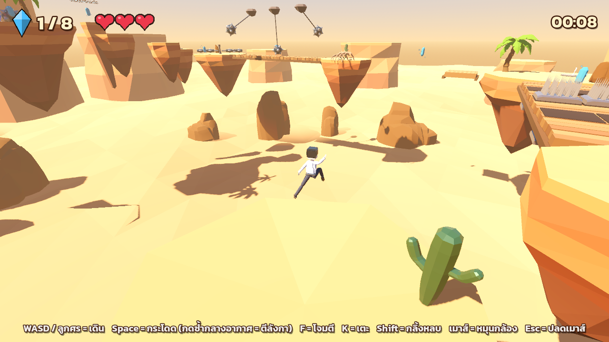

# Lab 6 – สร้างตัวละคร 3D (Oasis Quest)

นาย พุฒิพงศ์ พานิชพันธุ์ 673380335-3 · AI กลุ่ม 2 · วิชา Computer Game Development

**ทดลองเล่น:** https://super-super-dev.github.io/lab6_prod/

ตัวละครนักศึกษาที่สร้างใน Blender (ใช้ภาพใบหน้าตนเอง) ถูกนำไปเป็น **Player ในเกมแบบฝึกหัดที่ 5**
(Oasis Quest – 3D platformer เก็บคริสตัล 2 ด่าน) และมีฉาก **Character Demo** ให้เลือกดูท่าทางทั้งหมด
จาก Melee และ Shooter library (กดปุ่ม "ดูท่าทางตัวละครทั้งหมด" ที่หน้าแรก)

## ขั้นตอนที่ทำ

1. **Blender 4.5:** สร้างตัวละครชุดนักศึกษา ใช้ภาพใบหน้าตนเองเป็น texture บนหัว (`blender_source/`)
   - `build_character.py` สร้างโมเดล, Armature และ export `.glb` (กระดูกตั้งชื่อแบบ Mixamo: `mixamorig_Hips`, `mixamorig_Spine` …)
   - `export_mixamo_fbx.py` export เฉพาะ mesh + texture เป็น FBX สำหรับอัปโหลดเข้า Mixamo auto-rigger
2. **Mixamo:** อัปโหลด FBX เพื่อทำ auto-rig โครงกระดูกมาตรฐาน Mixamo
3. **Godot 4.7:** import ตัวละครแล้วตั้ง Retarget ด้วย `Mixamo BoneMap.tres`
   (โครงกระดูกถูกเปลี่ยนเป็น `GeneralSkeleton`) จากนั้นใส่ Animation Library จาก
   [Godot4-OpenAnimationLibraries](https://github.com/catprisbrey/Godot4-OpenAnimationLibraries)
   ทั้ง `MeleeLib.res` และ `ShooterLib.res`
4. **ใช้เป็น Player ในเกม Lab 5:** `Scripts/CharacterAnims.gd` จับคู่ชื่อท่าของเกมกับท่าใน library

   | ท่าในเกม | ท่าจาก library |
   |---|---|
   | Idle / Run / Jump / Fall | `shooter/idle`, `shooter/run_067`, `shooter/jump`, `shooter/fall` |
   | ตีลังกา (กระโดดซ้ำกลางอากาศ) | `melee/Roll` |
   | โจมตี 3 จังหวะ (F) | `melee/Slash1` → `melee/Slash2` → `melee/Stab1` |
   | เตะ (K) | `shooter/kick1` |
   | กลิ้งหลบ (Shift) – ไม่โดนกับดักระหว่างกลิ้ง | `shooter/roll` |
   | โดนกับดัก / หัวใจหมด | `shooter/hurt1`, `melee/Die1` |
   | ชนะ (หน้า Win) | `shooter/handsup-idle` |

5. **Export Web** (GL Compatibility) แล้ว push ไฟล์ build ไปที่ repo `lab6_prod` เปิดด้วย GitHub Pages

## การควบคุม

| ปุ่ม | ในเกม | ในฉาก Character Demo |
|---|---|---|
| WASD / ลูกศร | เดิน | เดิน |
| Space | กระโดด (กดซ้ำกลางอากาศ = ตีลังกา) | กระโดด |
| F / คลิกซ้าย | โจมตี (กดต่อเนื่อง = คอมโบ) | – |
| K / คลิกขวา | เตะ | – |
| Shift | กลิ้งหลบ | วิ่ง |
| เมาส์ | หมุนกล้อง | ลากเมาส์ / Q E หมุนกล้อง, ล้อเมาส์ซูม |
| 1-9 | – | Slash, Heavy, Stab, Punch, Kick, Roll, Potion, Shrug, Die |
| Esc | ปลดเมาส์ | – |

## โครงสร้างโปรเจกต์

- `Assets/Character/` ตัวละครนักศึกษา (`.glb` + texture ใบหน้า, import ด้วย Mixamo bone map)
- `Assets/Animations/` `MeleeLib.res`, `ShooterLib.res`, `mixamo_bone_map.tres`
- `Scenes/player.tscn`, `Scripts/player.gd` Player ของเกม (controller จาก 3D Platformer Starter Kit + ท่าโจมตี/กลิ้ง)
- `Scenes/Demo/CharacterDemo.tscn` ฉากเดโมเลือกดูทุกท่า (220 ท่า)
- `Scenes/Levels/`, `Scenes/Prefabs/`, `Scenes/UI/` ด่าน กับดัก และหน้าจอของเกม Lab 5
- `tools/` สคริปต์ช่วย: `build.gd` สร้างฉาก, `playtest.gd` ทดสอบด่านอัตโนมัติ, `actionshot.gd`, `flowtest.gd`, `student_poses.gd`

## Credits

- เกมพื้นฐาน: Lab 5 Oasis Quest บน 3D Platformer Starter Kit (The Silver Demons, CC0)
- Animation: Godot4-OpenAnimationLibraries (catprisbrey) – ท่าจาก Mixamo
- โมเดลฉาก: Quaternius, Kenney, iPoly3D ผ่าน Poly Pizza (CC0)
- เสียง: Juhani Junkala และ Kenney (OpenGameArt, CC0)
- ฟอนต์: Kanit (SIL Open Font License)
